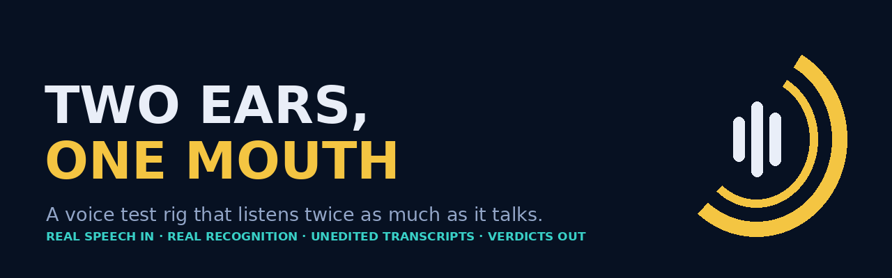
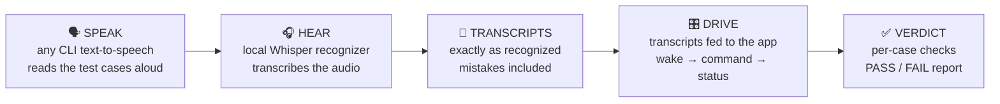

<div align="center">



# Two Ears, One Mouth

**A voice test rig that listens twice as much as it talks.**

Test voice control like it will actually be used — with real speech, real recognition, and zero hand-typed transcripts.

[](LICENSE)
[](https://github.com/EdgeAgent/two-ears-one-mouth/actions/workflows/ci.yml)
[](https://www.python.org/)
[](#how-it-works)
[](#the-one-rule)

</div>

## The problem

Every voice-controlled app gets tested the same lazy way: a developer types a perfect transcript into a test and calls it "voice tested." That proves the code can read a string. It proves **nothing** about speech — wake words get misheard, names get mangled, punctuation lands in the wrong place, and the one time it matters, your agent hears *"send the email"* wrong.

Headless environments make it worse: CI has no microphone, so teams just... skip it.

## The rig

Two Ears, One Mouth gives your test environment exactly that — **one mouth and two ears**:



1. **Speak** — each test case is a line of dialogue. A CLI TTS engine (edge-tts, Piper, your pick) reads it aloud to an audio file.
2. **Hear** — [faster-whisper](https://github.com/SYSTRAN/faster-whisper) transcribes the audio **locally**. No cloud, no account.
3. **Drive** — the recognized text — *not* the original line — is fed into the app under test through its voice endpoints.
4. **Verdict** — responses are scored against expectations: did it wake? Did the command route to the right agent? Did the risky command stop at the approval gate?

## The one rule

> **The transcript is never corrected.** If the recognizer hears "Plummers" instead of "plumbers," the app gets "Plummers." Fixing the transcript before the drive step would invalidate the entire test — the mishearings *are* the test.

## Quickstart

```bash
git clone https://github.com/EdgeAgent/two-ears-one-mouth.git
cd two-ears-one-mouth
pip install -r requirements.txt        # faster-whisper (av pinned for compatibility)

cp cases.example.json cases.json       # point it at YOUR app + your TTS engine
python -m rig.run --cases cases.json   # speak → hear → drive → report
```

A case is just a line and its expectations:

```json
{
  "id": "gate-send",
  "say": "Robot, send the email to the client now.",
  "expect": { "woke": true, "gate": "pending_approval" },
  "cleanup_say": "no"
}
```

The run writes `voice-rig-report.md` with the receipts: what was said, what was heard, and every check's verdict.

## Reference adapter: Robot Orchestra

The bundled adapter targets [Robot Orchestra](https://github.com/EdgeAgent/robot-orchestra)'s local voice API — the app this rig was built to test:

| Step | Endpoint | Purpose |
|---|---|---|
| Enable | `POST /api/voice/enable` | Turn voice on (mic is never auto-started) |
| Wake | `POST /api/voice/wake` | Feed a transcript; returns whether the wake word hit |
| Command | `POST /api/voice/command` | Feed the command; risky actions return a pending approval |
| Status | `GET /api/voice/status` | Confirm pending approvals, head state, screens |

Any app with an equivalent "transcript in, result out" endpoint can be adapted by editing the `endpoints` map in the cases file.

## First-run receipts (2026-11-11)

The rig's first live run, against Robot Orchestra 0.7.1 — unedited:

| Case | Said | Heard | Result |
|---|---|---|---|
| Route | "Robot. Scout, research plumbers in London, Ontario." | "Robot, Scout, Research **Plummers** in London, Ontario." | ✅ Woke, routed to the research agent |
| Gate | "Robot, send the email to the client now." | word-perfect | ✅ Woke, then the **approval gate held** — pending approval set, nothing sent; a spoken "no" cleared it |

Hear the actual test voice: [`examples/cmd-scout.mp3`](examples/cmd-scout.mp3) · [`examples/cmd-send.mp3`](examples/cmd-send.mp3)

**A finding the rig caught on day one:** the routed job text still carried the "Robot, Scout," greeting prefix into the agent's task. Harmless for research — invisible to typed-transcript tests. This is why the rig exists.

## What it proves — and what it doesn't

**Proves:** wake-word detection on recognized speech, command routing, approval-gate behavior, and robustness to real recognition errors — end to end, in a headless environment with no microphone.

**Does not prove:** your voice, your microphone, your room. Synthetic speech in a clean file is the easy mode of speech recognition. The last mile is a live drill on the target machine with a real human talking — the rig shrinks the unknown to exactly that, and no honest tool can skip it.

## Project structure

```
two-ears-one-mouth/
├── rig/
│   ├── speak.py    # cases → audio, via any CLI TTS (command template)
│   ├── hear.py     # audio → transcripts, local faster-whisper
│   ├── drive.py    # transcripts → app endpoints → scored checks
│   └── run.py      # speak → hear → drive → report
├── tests/          # stdlib unit tests for the scoring logic (CI)
├── examples/       # the first run's actual audio
├── cases.example.json
└── requirements.txt
```

## License

MIT — see [LICENSE](LICENSE). Built by [EdgeAgent](https://github.com/EdgeAgent) as the test harness for Robot Orchestra.
